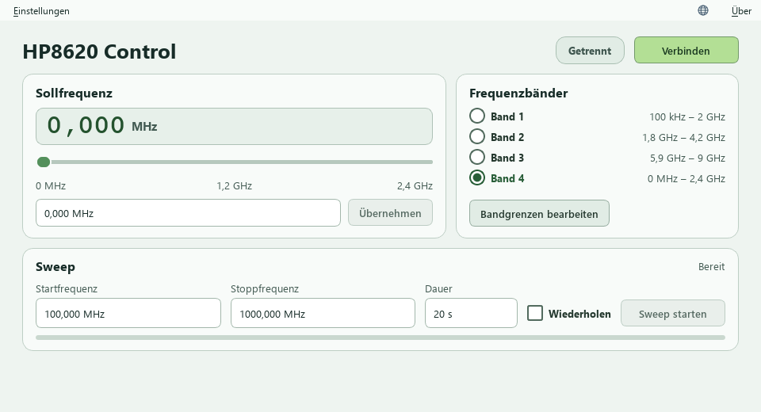
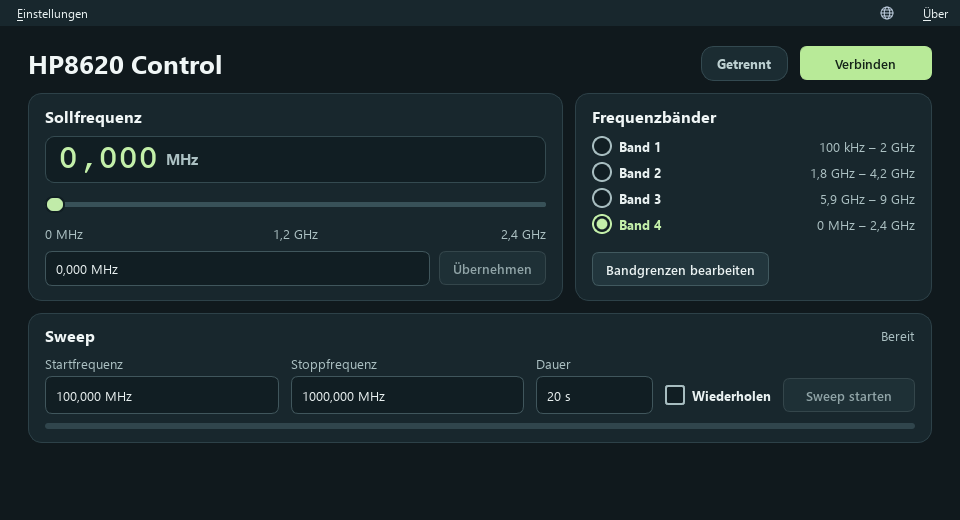

# HP8620 Control

Eigenständige Windows-Anwendung für die GPIB-Steuerung des HP8620 mit Qt Widgets. Die Versionsnummer steht in [version.h](version.h).

Entwickelt und gepflegt von Ralf Tralow mit Unterstützung von OpenAI Codex.

Die Anwendung ist eine Neuimplementierung der HP8620-Steuerung aus dem ursprünglichen Java-Projekt OsciViewer von Ralf Tralow. Die Bandvorgaben und die Gerätebefehle stammen aus diesem Projekt. [OsciViewer auf SourceForge](https://sourceforge.net/projects/osziviewer/)

## Bildschirmaufnahmen

| Hell | Dunkel |
| --- | --- |
| <a href="docs/screenshots/hp8620-hell.png"></a> | <a href="docs/screenshots/hp8620-dunkel.png"></a> |

## Installation

Die aktuellen Windows-Setups für x86 und x64 stehen unter [Releases](https://github.com/GitterRalf/hp8620-control/releases). Der Standardordner für x64 ist **C:\Programme\HP8620 Control**. Für die Installation sind Administratorrechte nötig. Der zum Adapter passende NI-488.2- oder USB-COM-Treiber wird separat installiert.

## Bedienung

1. Unter **Einstellungen → Verbindung** den Adapter wählen und mit **Übernehmen** bestätigen. Für NI-488.2 sind GPIB-Bus **0** und Primäradresse **6** voreingestellt. Beim Elektor USB-GPIB den virtuellen COM-Port sowie die GPIB-Primäradresse einstellen.
2. **Verbinden** aktiviert die externe CW-Steuerung (Modus M1) und wählt das angezeigte Band. Mit **Übernehmen**, Enter im Sollfrequenzfeld oder durch Bewegen des Schiebereglers wird die Sollfrequenz übertragen. Beim Ziehen sendet der Regler beim Loslassen.
3. Die vier Frequenzbänder sind wie in OsciViewer vorbelegt. Über **Bandgrenzen bearbeiten** lassen sich die Werte an den Einschub anpassen. Frequenzen werden in MHz eingegeben. Das Dezimaltrennzeichen richtet sich nach der gewählten Sprache.
4. Für einen **Sweep** Start, Stopp und Dauer eingeben. Start und Stopp müssen innerhalb des aktiven Bands liegen. Der Sweep läuft auf- oder abwärts mit optionaler Wiederholung. **Sweep stoppen** hält die zuletzt gesendete Frequenz.
5. **Einstellungen → Darstellung** schaltet sofort zwischen **Hell** und **Dunkel** um. **Einstellungen → Einstellungen speichern** (Strg+S) speichert die Darstellung, den Adapter, die Adresse, die Bandgrenzen, die Sollfrequenz und die Sweep-Einstellungen für den nächsten Start. **Trennen** und das Schließen des Fensters geben das Gerät per GPIB an die lokale Bedienung zurück.
6. Das **Globus-Symbol** rechts in der Menüleiste wechselt zwischen Deutsch, Englisch und Französisch und merkt sich die Auswahl für den nächsten Start. Das Menü **Über** zeigt Informationen zur Anwendung und zu Qt. **Nach Updates suchen** prüft das letzte stabile Release nur auf Wunsch und öffnet bei einer neueren Version die Release-Seite im Browser. Solange das Repository privat ist, benötigt die Abfrage die [GitHub CLI](https://cli.github.com/) und ein per `gh auth login` angemeldetes Konto mit Zugriff.

Die große Anzeige zeigt die vorgegebene Frequenz. Die Anwendung berechnet daraus die Steuerspannung des HP8620C Option 011 anhand der konfigurierten Bandgrenzen. Die Endpunkte entsprechen 0 und 10 V. Der Rechner erzeugt die Zwischenwerte des Sweeps und überträgt sie in dem vom Adapter und Gerät möglichen Takt. [HP Application Note 187-5](https://www.hpmemoryproject.org/an/pdf/an_187-5.pdf).

## Windows-Build

Benötigt werden CMake, ein zum Qt-Kit passender C++17-Compiler und Qt 6 mit Widgets, Network, Serial Port und Linguist Tools. In Qt Creator lässt sich die CMakeLists.txt direkt öffnen. Alternativ mit dem Qt-MinGW-Kit in PowerShell:

```powershell
$qtKit = 'C:/Qt/Qt6/6.11.0/mingw_64'
$compiler = 'C:/Qt/Tools/mingw13_1_0/mingw64/bin'
$env:Path = "$compiler;$qtKit/bin;" + $env:Path
cmake -S . -B build -G Ninja "-DCMAKE_PREFIX_PATH=$qtKit" "-DCMAKE_CXX_COMPILER=$compiler/g++.exe" -DCMAKE_BUILD_TYPE=Release
cmake --build build
& "$qtKit/bin/windeployqt.exe" --release --no-translations --no-system-d3d-compiler --no-opengl-sw '.\build\HP8620-Control.exe'
```

Für den Hardwarebetrieb benötigt der NI-Adapter einen installierten NI-488.2-Treiber mit Unterstützung für die Programmarchitektur. Der Elektor-Adapter benötigt die klassische Elektor-Firmware mit W-/G-Kommandos und einen passenden USB-COM-Treiber. [Elektor, April 2011](https://d1.amobbs.com/bbs_upload782111/files_49/ourdev_708675KI0LUX.pdf).

Das Skript `.\build.ps1` baut und stellt die Laufzeitdateien im Build-Ordner bereit. Anschließend erstellt Inno Setup aus [HP8620-Control.iss](HP8620-Control.iss) die Setup-Datei im Ordner **installer**.

Der HP8620-Quellcode und das animierte OsciViewer-Logo von Ralf Tralow stehen unter der [MIT-Lizenz](LICENSE). Die Lizenzhinweise zur Laufzeit stehen in [THIRD-PARTY-NOTICES.txt](THIRD-PARTY-NOTICES.txt).

### Windows-Architekturen

Die x86-Ausgabe verwendet Qt 5.15.19 mit MinGW 8.1 und hat einen eigenen
Installationsordner **HP8620 Control (32 Bit)**. Auf 64-Bit-Windows können beide
Ausgaben parallel installiert werden. Die x64-Ausgabe verwendet weiterhin
Qt 6 und ist beim Build der Standard.

Der Build für x86 nutzt `build-x86`, der Build für x64 den Ordner `build`.
Die Installer entstehen im Projektordner mit folgenden Aufrufen.

```powershell
ISCC.exe HP8620-Control.iss
ISCC.exe /DBuildArch=x86 HP8620-Control.iss
```
